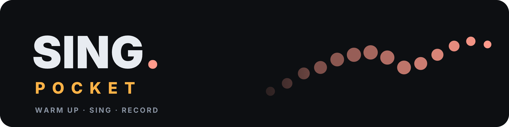
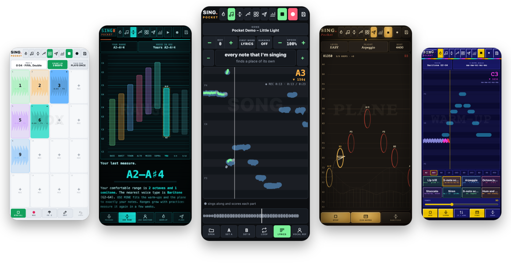
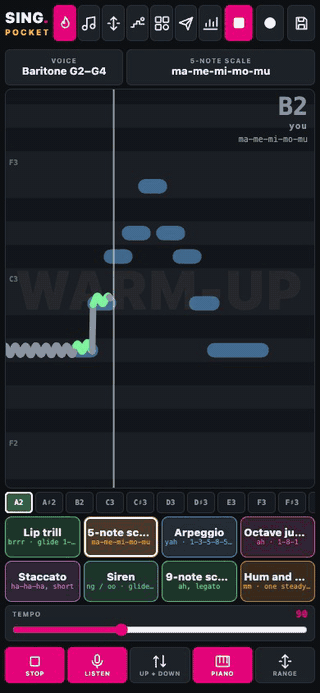
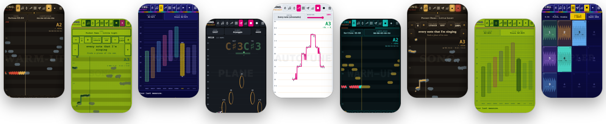
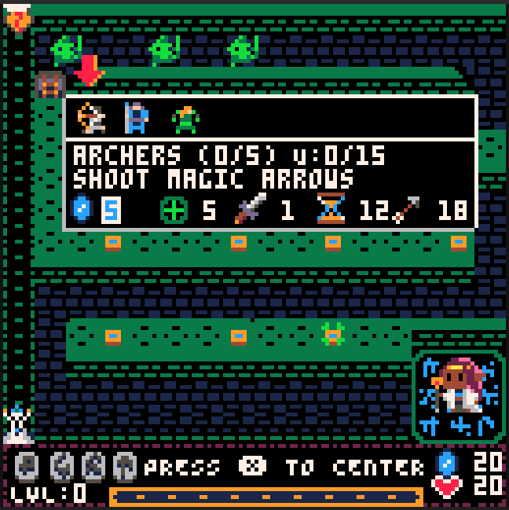
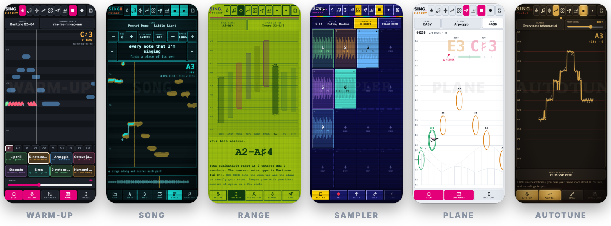
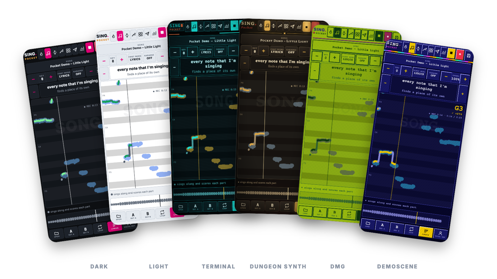

# SING.Pocket

Sing is the result of me not doing my vocal exercises daily enough. Singing has brought me a lot of happiness, and I kinda wanted something to have an excuse to practice more technique and less carpool karaoke. This is an amateurs idea of a vocal coach app, so bear with me. It kinda does what I need right now, and I hope you find it useful.

SING.Pocket is a pocket vocal coach: warm-ups that follow your voice, song practice with key and speed change, A-B loops, lyrics, a pitch test that shows where you sang in tune and where you didn't, recorded takes, a range finder, autotune, a sampler for your voice and a singing game. It is the sister app of [TRACK.Pocket](https://github.com/utopick/track-pocket) and [TUNE.Pocket](https://github.com/utopick/tune-pocket), and runs from one self-contained HTML file, with no install and no dependencies.

It should run fully offline, although opening the HTML file directly can cause microphone permission issues, so use the hosted GitHub page instead or self-host the HTML.

The one exception is the **lyrics search**: you don't need a connection to use the app, but searching for lyrics (FIND) won't work offline. Without a connection you can still paste lyrics or open an `.lrc` file.

**Open it:** [utopick.github.io/sing-pocket](https://utopick.github.io/sing-pocket/) · **Install it:** it is a web app (PWA): on Android, Chrome ▸ **Install app**; on iPhone, Safari ▸ Share ▸ **Add to Home Screen**; on a computer, the install icon in the address bar. Once installed it opens like an app and works offline.

I've been adding features and tweaking a lot, so they come out not fully tested, and there could be bugs. Leave me an issue and I'll fix it.

There is a help wiki inside (también en español), with small interactive demos you can drag around: a warm-up lane, the range finder, autotune and a pocket-size plane flight.

## Why did I release these apps? 

Because GitHub allows me to host them in a GitHub site if I make them public, and I don't want to host them myself. 

Also because my friends told me that they are useful and some of you may want a free, ad-less gadget to pass the time.

## Ads and cookies

Yeah, no.

No ads, no cookies, no nothing. This is free and clean. No hidden stealers, no weird intentions.

Why is it free? Because not everything should be a product.

## AI use

I'm a programmer and I have been coding for a living for over two decades, but life has given me too little free time that I want to spend offline and outside, making music and art. So I used a lot of AI to build this in a quick and easy way.

I'm not going to take credit for the code, even though I started this app from my own older code. I built it with the help of an AI coding assistant (Claude, by Anthropic), which wrote and reworked much of the code following my designs and notes.

The app itself uses no AI: everything runs on your device, and nothing you play, sing or record is sent to any AI service or anywhere else for that matter. The one exception is the lyrics search: when you tap **FIND**, the song's title and artist go to [lrclib.net](https://lrclib.net). If anything else leaves your phone, just shame me publicly and I'll fix it.

I did waste a lot of tokens by making it code it in a non-minified way, so if the bubble bursts and we go back to the basics it could be maintainable. 

If you want to try something made by me by hand (95%, I did use an early model to find some bugs but solved them by hand) in which I made the code, assets, music and all, check out Nanaya, my Pico-8 tower defense game: https://www.lexaloffle.com/bbs/?tid=153336

## How to run it

Open `index.html` in a modern web browser. The microphone needs `https://` or `localhost`, which is why the hosted page (or the installed app) is the easy way.

## The basics

- **Warm-up:** 8 exercises (lip trill, 5-note scale, arpeggio, octave jump, staccato, siren, 9-note scale, hum) for six voice types or your own range. Each one climbs a semitone at a time through your range and back down. The lane shows the target notes and your live pitch, and every key gets a score.
- **Song:** open an MP3, M4A, WAV, OGG, FLAC or MP4 from the phone.
  - **KEY:** transpose −12 to +12 semitones without changing the speed.
  - **SPEED:** 50–120% without changing the pitch. Both use a WSOLA time stretch done in the app.
  - **KARAOKE:** turns the centre of the mix (usually the voice) down.
  - **Loops:** tap the overview to jump, drag it (or use SET A / SET B) to loop a part.
  - **LYRICS:** search lrclib.net (this needs a connection), paste them, or open an `.lrc` file.
  - **Pitch test:** **●** records you singing along and scores each lyric line. Tap a weak line to loop it.
- **Range:** hold your lowest and highest comfortable notes. A chart puts your range beside the six voice types and your earlier measures, and **USE MINE** fits the warm-ups and the game to it.
- **Autotune:** live through headphones (natural or hard, every note or a key), with a trace of your voice and of what you hear, and tuned copies of any recording.
- **Sampler:** for your voice, with 16 pads. Record a verse after a count-in, overdub harmonies on it, crop it, reverse it, change its pitch, and bake in effects (reverb, echo, double, chorus, third and fifth harmonies, octaves, autotune, radio, lo-fi…). Samples stay on the phone, and **SAVE** sends one to Files.
- **Plane:** a paper plane flies through hoops, and your voice steers it. The hoops follow a warm-up exercise in your range, on three levels (Easy forgives the octave and helps you aim). It's a warm-up in disguise.
- **History:** days in a row, minutes a day, your warm-up and song scores over time, your flights and your range measures.
- **Files** (last button): your songs and recordings. Play a take, open it in Autotune, export it (compressed, Opus or AAC), or delete it. **●** here records a free session.

### Themes

Six looks, from **THEME** at the bottom of the Files screen: Dark, Light, Terminal, Dungeon synth, DMG and Demoscene. All three Pocket apps share them.

### About the melody

The reference melody is estimated from the full mix: the centre of the stereo image, band-passed to the voice range, with an autocorrelation pitch tracker. Loud instruments can fool it. Load an a cappella (vocal-only) version of the song with **VOCAL REF**, and that file becomes the melody you sing against.

### About YouTube

The app does not download from YouTube. Downloading is against YouTube's terms of service, and its embedded player doesn't let other apps change the pitch. Use songs you have as files.

Why is this in the readme? Well, me and the model, we had a long token consuming talk about pros and cons. He won, so BYOM.

### Your songs and takes

Songs, takes and Sampler pads are stored in your browser (IndexedDB), settings in `localStorage`; they are not uploaded anywhere. Clearing browser storage removes them, so export the takes you want to keep.

## Install it as an app (PWA)

SING.Pocket is a progressive web app (PWA): the hosted page can be installed on the home screen or desktop, opens in its own window without browser bars, and keeps working with no connection. There is no store and no download. The first visit has to be online; after that it starts offline.

### iPhone and iPad (iOS)

1. Open [utopick.github.io/sing-pocket](https://utopick.github.io/sing-pocket/) in **Safari** (other iOS browsers cannot install web apps from the share menu).
2. Tap **Share**, then **Add to Home Screen**, then **Add**.
3. Open it from the new icon. The microphone asks for permission the first time you use it.

Notes: Safari on iOS has no Web MIDI, so MIDI keyboards and pads do not work there. On iOS, Safari deletes the data of websites you have not used for 7 days, but an app added to the Home Screen is exempt from that rule: so install it, rather than keeping it in a Safari tab. Even so, export what you want to keep (iOS can still free storage when the phone is nearly full).

### Android

1. Open the page in **Chrome** (Edge, Brave and Samsung Internet work too).
2. Choose menu ⋮ ▸ **Install app** (or **Add to Home Screen**), or accept the install banner if it shows.
3. Open it from the icon. Allow the microphone when asked; if you refused it, tap the lock icon in the address bar of a normal tab (or **Settings ▸ Apps ▸ SING.Pocket ▸ Permissions**).

MIDI keyboards and pads over USB or Bluetooth work in Chrome (Web MIDI).

### Desktop (Windows, macOS, Linux, ChromeOS)

1. Open the page in **Chrome** or **Edge** and click the install icon at the right end of the address bar (or menu ▸ **Install SING.Pocket**).
2. It opens in its own window and can be pinned to the taskbar or dock.
3. Firefox and Safari on desktop can use the page in a tab, but do not install it; Firefox also has Web MIDI, Safari does not.

### Good to know

- **Updates:** whenever it is online the app fetches the newest version; close and reopen it to run it.
- **Your data** lives in the browser's storage for this site (the installed app and a tab of the same browser share it). Export songs and recordings you want to keep before clearing browser data or switching device.
- **The Android APK is retired.** It was a Capacitor wrapper of this same page; the PWA does the same job without a build. The code stays in the [`android-legacy`](https://github.com/utopick/sing-pocket/tree/android-legacy) branch and the old APKs in [Releases](https://github.com/utopick/sing-pocket/releases); neither gets updates.

### Why is there a service worker (`sw.js`)?

Browsers only allow an app to work offline, and only offer to install it, if the site registers a **service worker**: a small script that sits between the page and the network. This one does a single job: on the first visit it saves the app's own files (`index.html`, the manifest and the icons) in the browser's cache, and afterwards it answers from that cache when you are offline. It asks the network first, so when you are online you always get the latest version. It cannot be part of `index.html`, because browsers load it as a separate file, and it never touches your songs, recordings, microphone or MIDI, and sends nothing anywhere.

## Browsers and systems: what works where

The Pocket apps that listen (TUNE's tuner and looper, SING, PLAY) depend a lot on the browser and the system, more than on the phone or computer. Hearing yourself through the app while you play is the hard case: it needs the sound to go out and come back in quickly. These are round trips we measured in November 2026, with a cable from the audio interface's output back into its input, using [LAB.Pocket](https://utopick.github.io/test/latency-lab/) and PLAY.Pocket's latency test:

| System | Browser | Round trip | Play through it? |
|---|---|---|---|
| Mac + Focusrite Scarlett Solo | Chrome | 18–20 ms | yes |
| Mac + Focusrite Scarlett Solo | Firefox | 18 ms | yes (mind the output, below) |
| Mac + Focusrite Scarlett Solo | Safari 26 | about 110 ms | no |
| Android 16 phone, USB guitar cable or its mic | Firefox | 30–33 ms | yes |
| Android 16 phone | Chrome, and every browser built on it | 110–340 ms | no |
| iPad (2019), iPadOS 18 | Safari, and every other iOS browser | 77–127 ms, built-in mic only | no |

Under about 30 ms it feels like an amp; up to 60 ms it is playable with a little lag; beyond that it is an echo. Tuning, recording and playback work everywhere: only live monitoring needs the fast ones.

### The nitpicks

- **Use one interface for input and output.** Two devices run on two clocks: the Scarlett in and the Mac's headphone jack out gave 52–55 ms instead of 19.
- **Match the sample rate.** If the app runs at 44.1 kHz and the interface at 48 kHz, the browser converts between them, which costs about 6 ms. Chrome tells the app the input's rate, so it matches it by itself; Firefox does not, so set the rate by hand there (48000 Hz for most interfaces).
- **Firefox and the output choice.** Chrome can send the sound straight to any output. Firefox can only do it through its media player, which buffers for smooth music: 72 ms instead of 18. In Firefox, leave the app's output on system default and choose the output in the system's sound settings.
- **Raw input.** The browser's echo cancelling, noise suppression and automatic gain are made for calls: they add delay and change your tone. The apps turn them off.
- **The buffer setting barely matters.** The browser's "interactive" mode is already its smallest buffer; asking for 5 ms gained 1–2 ms on a computer and nothing on Android.
- **Distortion oversampling** (smoother drive) costs 3 ms at 2× and 4 ms at 4×.
- **Android:** Chrome's microphone path is slow, and it is the same in Edge, Brave, Samsung Internet and in-app browsers. Firefox uses Android's fast audio path: use Firefox to play through the app.
- **iPhone and iPad:** every browser there is Safari underneath. Once a page opens the microphone it records the built-in mic even when a USB interface is chosen ([WebKit bug 211192](https://bugs.webkit.org/show_bug.cgi?id=211192)), moves the sound to the iPad's own output, and lags more and more after the iPad sleeps. Pages that only play sound (TRACK) do play through an interface. Native apps like AUM use the interface fine: it is the browser, not the iPad.
- **Your hands count too.** Played by hand, the same test reads about 20 ms more than with a cable: most people play slightly after a click they hear.
- **The apps stop listening in the background**, so they never come back with a stuck microphone after the screen locks.

## Files

- `index.html` — the complete app (markup, styles, audio code and the MIDI panel)
- `manifest.webmanifest`, `sw.js`, `icons/` — what makes it installable and offline (see above)
- `docs/` — notes for whoever maintains it; `tests/` — automated checks (`tests/e2e.py`, Selenium) and a test for the MIDI helpers
- `LICENSE` — license terms

## License

SING.Pocket is released under the MIT License (see `LICENSE`).

AI assisted coding uses the uncredited work of a lot of coders through the years (me included) so anything I make that's not for work its as free as possible.

Have fun.

### Third-party code

The banner, app icons and favicons are lettered in [Inter](https://rsms.me/inter/) (SIL Open Font License 1.1), converted to shapes, so no font file is included. The app itself has no third-party code.

## The readmes

Yeah. They are all similar. I copied and pasted. No one ever reads them all. Kilroy was here.

Anyway, listen to me: You matter. A lot. I don't know you stranger, but you have my admiration and love. Keep making art.